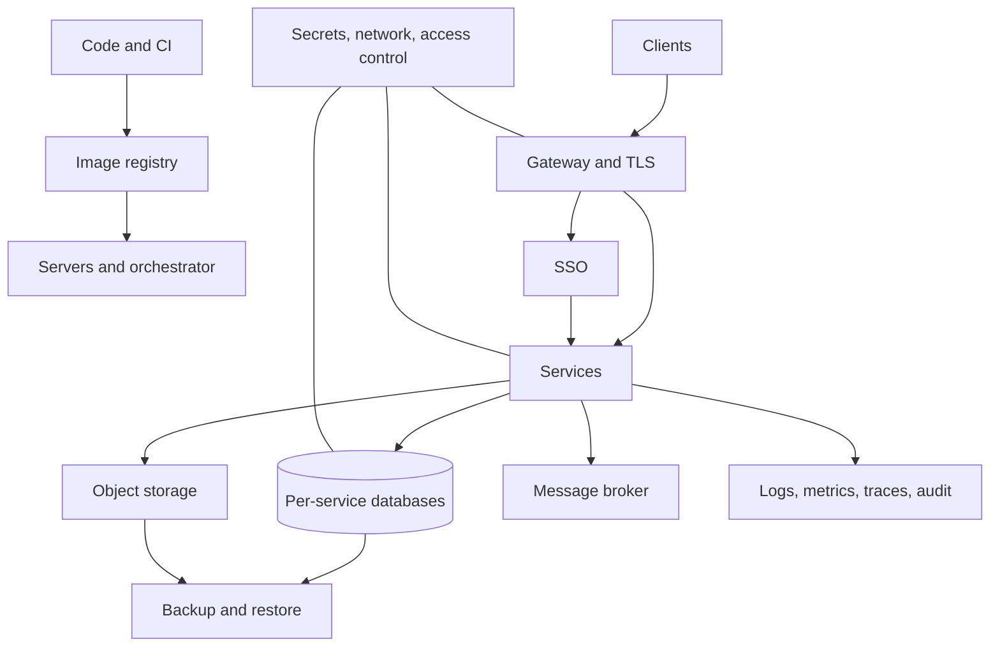

# Platform Overview

## Layers

## Components

| Layer | Responsibility | Location |
|---|---|---|
| Code and CI | Build, test, scan, version, publish images | `pipelines/` |
| Environments | Servers, networking, orchestration per environment | `infrastructure/` |
| Gateway | Public entry point, TLS, routing, rate limiting, token validation | `platform/gateway/` |
| Identity | SSO, OIDC, roles in Keycloak, permissions in apps | `platform/identity/` |
| Messaging | Asynchronous communication and events between services | `platform/messaging/` |
| Database | Database engines, provisioning, migrations convention | `platform/database/` |
| Backup | Backup schedules, retention, restore tooling | `platform/backup/` |
| Storage | Object storage for files | `platform/storage/` |
| Observability | Logs, metrics, traces, audit, alerting | `platform/observability/` |
| Secrets | Secret management and rotation | `platform/secrets/` |
| Services | Business capabilities | `services/` |
| Apps | Storefront and admin panel | `apps/` |

## Request path

1. Client calls the public domain over TLS.
2. Gateway terminates TLS, applies rate limits, validates the access token, and assigns a trace ID.
3. Gateway routes the request to the target service on the internal network.
4. Service authorizes the action based on token claims.
5. Service reads and writes its own database, stores files in object storage, and publishes events to the broker.
6. Logs, metrics, and traces from every hop are shipped to the observability stack.

## Network zones

| Zone | Contains | Reachable from |
|---|---|---|
| Public | Gateway only | Internet |
| Application | Services, identity provider | Gateway, other services |
| Data | Databases, broker, object storage | Application zone only |
| Management | CI runners, observability, backup storage | Operators via VPN or bastion |
