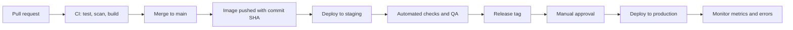

# Deployment Scenarios

## Default flow

## Scenarios

### 1. Standard service release (rolling update)

- **When:** normal changes to a service.
- **Steps:** run migrations (backward compatible) → replace instances one by one → each new instance must pass readiness before the next one is replaced.
- **Success criteria:** error rate and latency stay within thresholds for the observation window.
- **Rollback:** redeploy the previous image tag.

### 2. Canary release

- **When:** risky changes, high-traffic services.
- **Steps:** deploy the new version to a small share of traffic → compare error rate and latency with the current version → increase gradually → complete.
- **Rollback:** route all traffic back to the current version.

### 3. Blue-green release

- **When:** changes that cannot run side by side with the old version, or gateway and identity upgrades.
- **Steps:** deploy the new version as a full parallel environment → run smoke tests → switch traffic → keep the old environment for a defined period.
- **Rollback:** switch traffic back.

### 4. Release with database migration

- **When:** schema changes.
- **Steps (expand and contract):**
  1. Release A: add new columns or tables (no removal). Old and new code both work.
  2. Release B: code uses the new schema. Backfill data if needed.
  3. Release C: remove old columns or tables after no running version uses them.
- **Rule:** a backup or verified point-in-time recovery window must exist before any migration in `production`.

### 5. Hotfix

- **When:** urgent production issue.
- **Steps:** `hotfix/<topic>` branch → CI → review → deploy to `staging` → quick verification → deploy to `production` → merge back to `main`.
- **Rule:** the same pipeline is used. Hotfixes never skip CI or scanning.

### 6. Configuration or secret change

- **When:** changing configuration values or rotating secrets.
- **Steps:** update in the secret manager or `infrastructure/environments/<env>/` → rolling restart of affected services.
- **Rollback:** restore the previous value or secret version.

### 7. Platform component upgrade

- **When:** upgrading the gateway, identity provider, broker, database engine, or orchestrator.
- **Steps:** ADR if the change is significant → upgrade in `staging` → run full smoke tests → planned maintenance window if needed → upgrade `production` → monitor.
- **Rule:** take a fresh backup before upgrading any stateful component.

### 8. Identity (Keycloak) onboarding

- **When:** first deploy of SSO on a Kubernetes environment.
- **Steps:** provision PostgreSQL for identity with backup → build image from `platform/identity/upstream` at the pin in `VERSION` → apply `platform/identity/deploy/kubernetes/` (via environment overlay) → bootstrap admin from secret manager → run one-shot realm seed import for `customers` and `operators` → verify health and login smoke tests.
- **Docs:** [platform/identity/docs/deploy.md](../../platform/identity/docs/deploy.md), [seeding](../../platform/identity/docs/seeding.md).
- **Rule:** no themes in this phase; no real secrets in Git.

### 9. Object storage (MinIO) onboarding

- **When:** first deploy of platform file storage on a Kubernetes environment.
- **Steps:** provision PVC / nodes → apply `platform/storage/deploy/kubernetes/` (via environment overlay) → bootstrap secrets from secret manager → create buckets from `platform/storage/buckets/` → configure Console OIDC against Keycloak `operators` → deploy `file-service` with MinIO credentials → verify health and signed upload smoke test.
- **Docs:** [platform/storage/docs/deploy.md](../../platform/storage/docs/deploy.md), [console OIDC](../../platform/storage/docs/console-oidc.md), [file-service](../../services/file-service/README.md).
- **Rule:** no real secrets in Git; apps never hold root MinIO keys.

### 10. New service onboarding

- **Steps:** create `services/<name>/` from the conventions → register in `services/README.md` → register route in the gateway → register client in SSO → provision database, user, and backup → configure log and metric collection → complete the [go-live checklist](../go-live-checklist.md).

### 11. Disaster recovery

- **When:** loss of a node, data store, or entire environment.
- **Steps:** recreate infrastructure from `infrastructure/` → restore databases and files from backups → redeploy services from the registry → verify → switch traffic.
- **Procedure:** [disaster recovery runbook](../runbooks/disaster-recovery.md). Identity DB: [restore identity database](../runbooks/restore-identity-database.md). Object storage: [restore object storage](../runbooks/restore-object-storage.md).

## Deployment rules

- Only images from the project registry, referenced by immutable tag.
- No manual changes on servers.
- Every production deployment is recorded: who, what version, when, result.
- Avoid production deployments right before low-staffed periods unless it is a hotfix.
